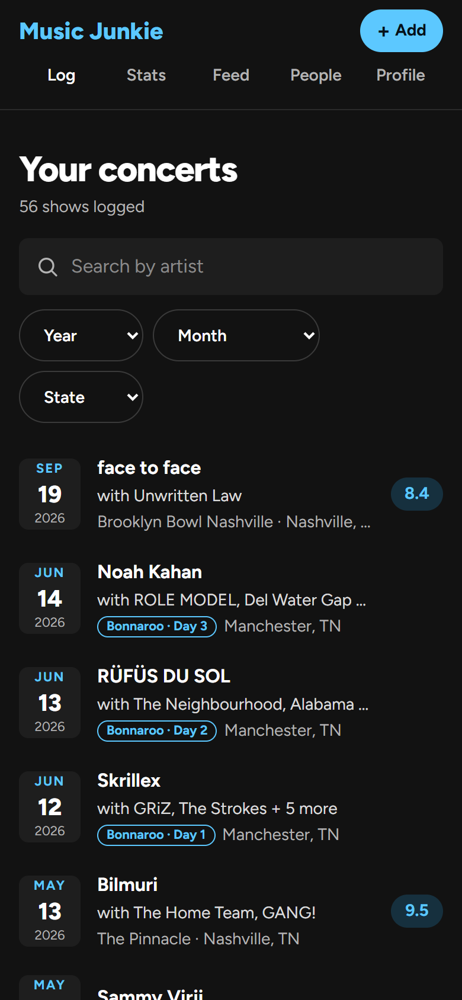
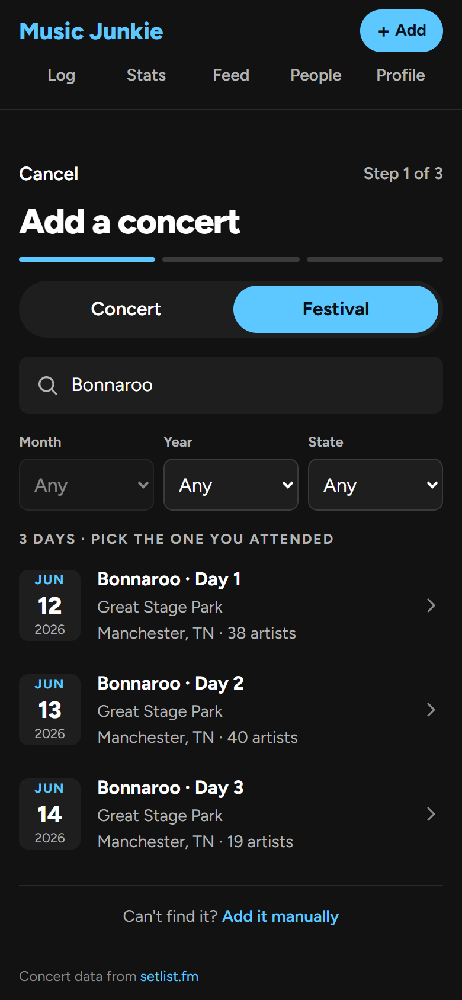
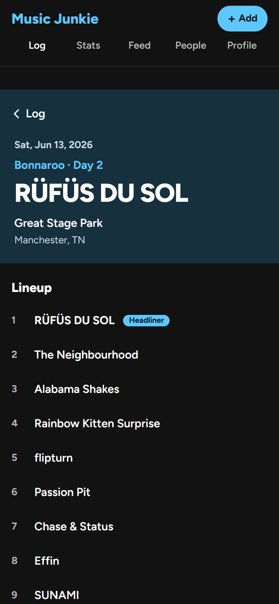
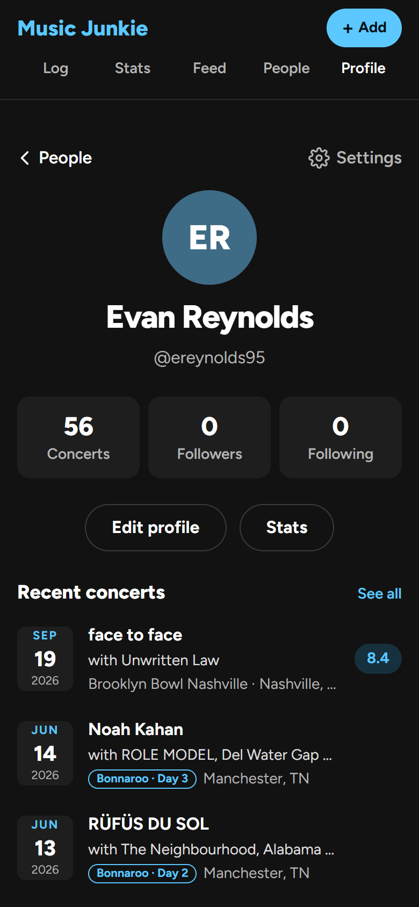
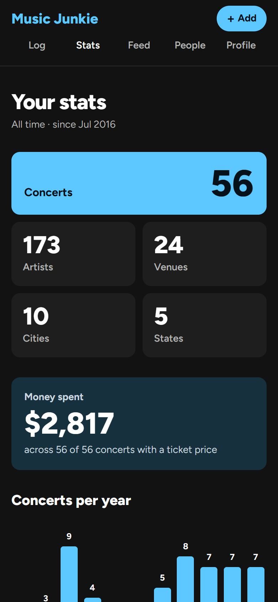
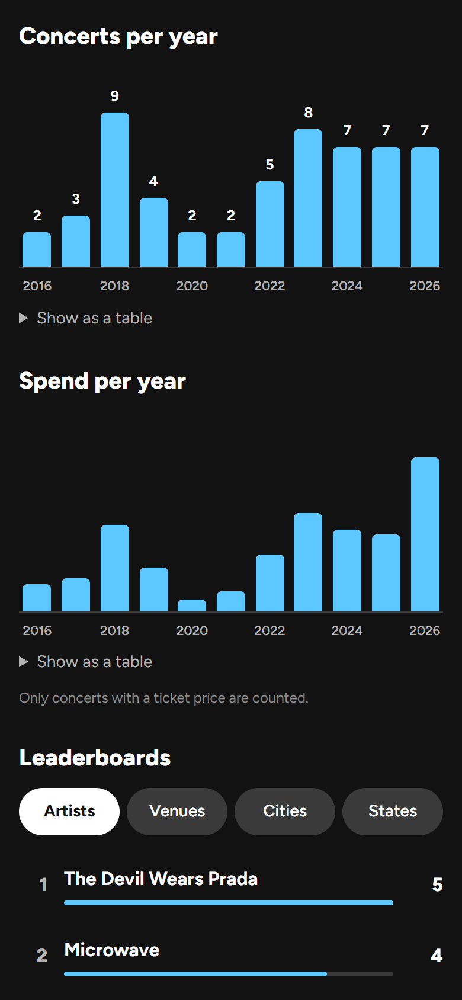
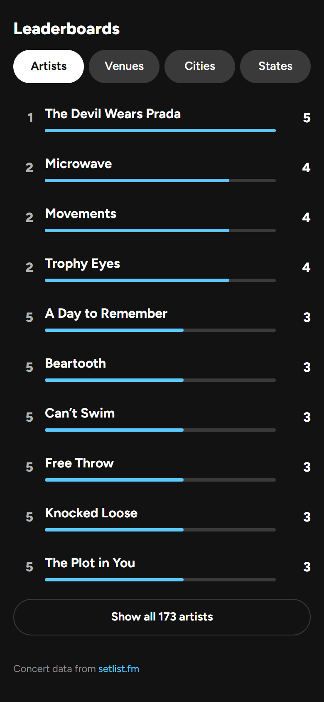

# Music Junkie

Log the concerts you've been to, see stats about your concert history, and follow friends to see their shows and the ones you both attended.

Search [setlist.fm](https://www.setlist.fm) for a show, confirm the lineup, and add your rating, ticket price and notes. Music Junkie keeps your log and works out the stats: how many shows, artists, venues, cities and states, how much you've spent, per-year charts and leaderboards.

This is a personal and portfolio project. It covers US shows only, and the web app comes first. A React Native (Expo) app on the same backend is planned.

## Screenshots

These are phone-width views of the web app.

| Your log | Adding a festival day | A concert | Profile |
| :---: | :---: | :---: | :---: |
|  |  |  |  |

| Stats | Per-year charts | Leaderboards |
| :---: | :---: | :---: |
|  |  |  |

## Features

- **Add a concert:** search setlist.fm by artist or venue, or by festival.
  - **Festivals:** pick the day you went. Multi-day festivals, festivals that move venues, and touring festivals like Warped Tour (one result per city stop) are all handled.
  - **Lineup:** drag to reorder or trim the lineup. The top artist is the headliner.
  - **Manual entry:** for anything that isn't on setlist.fm.
- **Your log:** every show, newest first. Filter by artist, year, month, state, city or venue.
- **Concert pages:** the full lineup, your rating, price and notes, a link to the headliner's setlist on setlist.fm, and "Also here", the people you follow who were at the same show.
- **Stats:**
  - totals, and money spent with how many shows had a price
  - concerts and spend per year, as charts with a table view
  - leaderboards for artists, venues, cities and states, each linking to a filtered log
- **Social:**
  - people search, follow and unfollow
  - private accounts with follow requests (accept, decline, remove a follower)
  - other people's profiles, logs and stats
  - an activity feed
- **Privacy:** enforced in the database, not just the UI. Every read goes through one rule, `can_view(viewer, owner)`, applied by Postgres row-level security and covered by tests.
- **Security:** audited in [`SECURITY_AUDIT.md`](SECURITY_AUDIT.md), with all findings addressed:
  - signed setlist.fm data, so nobody can plant venue or artist names
  - per-user search limits
  - a strict Content-Security-Policy
  - email confirmation
  - password re-entry to delete an account

## Stack

| Part | Tech |
| --- | --- |
| Monorepo | pnpm workspaces, Turborepo, TypeScript |
| Web | Next.js (App Router), Tailwind CSS |
| Backend | Supabase: Postgres with row-level security, Auth, Storage, Edge Functions |
| setlist.fm | Called only from the `setlist-search` Edge Function, so the API key never reaches the browser |
| Shared code | `packages/shared`: types, Zod schemas, formatting helpers, generated database types |
| Tests | Vitest (unit and API smoke tests), pgTAP (database and privacy tests) |

## Project layout

| Path | What |
| --- | --- |
| `apps/web` | Next.js web app |
| `packages/shared` | Code shared by the web app and the future mobile app |
| `supabase/migrations` | Schema, RLS policies and Postgres functions |
| `supabase/functions` | The `setlist-search` Edge Function. Its logic is in `_shared/setlistfm/`, including the festival list. |
| `supabase/tests/database` | pgTAP tests |
| `supabase/seed.sql` | Local seed data: three users, shows and follows |
| `tests/` | Vitest tests for the Edge Function logic and the API |
| `scripts/` | setlist.fm helper scripts |
| `docs/` | The spec, mockups, screenshots and setlist.fm notes |

## Running it locally

These steps are written for Windows (PowerShell or Git Bash). They also work on macOS and Linux.

### You'll need

- **[Node.js 24 LTS](https://nodejs.org)** (see `.node-version`).
- **[pnpm](https://pnpm.io/installation).** Its version is pinned in `package.json`.
- **[Docker Desktop](https://www.docker.com/products/docker-desktop/)** for the local Supabase stack. On Windows it needs WSL 2 and virtualization turned on in the BIOS.
- **A free [setlist.fm API key](https://www.setlist.fm/settings/api)** for concert search.

Nothing is installed globally: Turbo, the Supabase CLI and tsx are dev dependencies.

### 1. Install

```bash
pnpm install
```

### 2. Start Supabase

Start Docker Desktop first, then:

```bash
pnpm db:start
```

The first start downloads the Supabase images, applies every migration and loads `supabase/seed.sql`. To see the local URLs and keys:

```bash
pnpm db:status
```

### 3. Add your env files

Templates are committed. The real files are git-ignored, so keys never get committed.

| Copy | To | Fill in |
| --- | --- | --- |
| `apps/web/.env.example` | `apps/web/.env.local` | The local Supabase URL and publishable key from `pnpm db:status` |
| `supabase/functions/.env.example` | `supabase/functions/.env` | Your setlist.fm API key |
| `.env.example` | `.env` | Only needed for the scripts and API smoke tests: the setlist.fm key and the Supabase URL and keys |

### 4. Run the app

In one terminal:

```bash
pnpm dev
```

In a second terminal (needed for Add concert):

```bash
pnpm functions:serve
```

Open http://localhost:3000. Sign up with any email: the confirmation email lands in the local email testing server at http://127.0.0.1:54324, so open it there and click the link. Or use a seed account:

- `pat@example.com` (public)
- `priya@example.com` (private)
- `fran@example.com` (private, followed by pat)

The seed accounts' password is in the header comment of `supabase/seed.sql`. They only exist in your local database.

### 5. Stop

Press Ctrl+C in both terminals, then stop Supabase:

```bash
pnpm db:stop
```

Your local data is kept, and `pnpm db:start` brings it back.

**Deploying:** never run `supabase db reset --linked` or seed the hosted project. The seed accounts' password is public. In the hosted Supabase project, also turn on CAPTCHA (Turnstile or hCaptcha) and leaked-password protection. If `pnpm db:stop` fails on Windows with a `uv_spawn` error, stopping the `music-junkie` containers in Docker Desktop does the same thing.

## Commands

Run these from the repo root.

| Task | Command |
| --- | --- |
| Web dev server | `pnpm dev` |
| Serve Edge Functions locally | `pnpm functions:serve` |
| Build | `pnpm build` |
| Lint / typecheck | `pnpm lint` / `pnpm typecheck` |
| Format / check formatting | `pnpm format` / `pnpm format:check` |
| Unit tests (no Docker or network needed) | `pnpm test` |
| Database, privacy and API tests (needs local Supabase) | `pnpm test:db` |
| Start / stop / status of local Supabase | `pnpm db:start` / `pnpm db:stop` / `pnpm db:status` |
| Re-apply all migrations and the seed (**wipes local data**) | `pnpm db:reset` |
| Apply new migrations, keeping your data | `pnpm supabase migration up` |
| New migration | `pnpm supabase migration new <name>` |
| Regenerate database types after a schema change | `pnpm db:types` |
| Find the venues setlist.fm files a festival under | `pnpm find:festival-venue "<venue>" <city> <year>` |

## Tests

- **`pnpm test`:** 157 Vitest tests. They cover the shared helpers, the safe-redirect check, and the Edge Function's search, festival, lineup and signing logic, using a fake setlist.fm client.
- **`pnpm test:db`:**
  - **262 pgTAP assertions:** the privacy rules for every combination of viewer and owner, following rules, writes and constraints, logging, stats, social features, setlist links and the security fixes.
  - **25 API smoke tests:** the same rules checked through Supabase's API.

The privacy tests were checked against deliberately broken rules: weakening `can_view` makes them fail.

## setlist.fm

Concert data comes from [setlist.fm](https://www.setlist.fm) through its free API, which is for non-commercial use only. The app follows setlist.fm's terms:

- **Attribution:** every signed-in page credits setlist.fm with a link, and concert pages link to the headliner's setlist on setlist.fm. None of the links are marked nofollow.
- **API key:** only the Edge Function calls setlist.fm, and the key stays on the server.
- **Storage:** search results are cached in memory for a few minutes and never saved. A log stores only what you confirmed (your lineup, the venue and the date) plus setlist.fm IDs and links. Song lists are never stored.

Commercial use would need permission from setlist.fm.

## Status

Phases 0–5 of the build plan are done: setup, schema and privacy, adding concerts, the log, stats and social. Next is the rest of Phase 6: polish (loading and error states, accessibility, phone layouts) and deploying to hosted Supabase and Vercel. Its setlist.fm attribution task is done. The mobile app is Phase 7.

See [`PROGRESS.md`](PROGRESS.md) for where things stand and [`docs/spec.md`](docs/spec.md) for the full spec.
